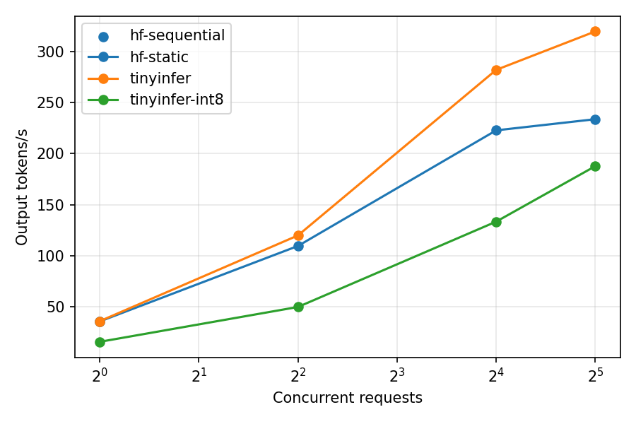

# TinyInfer

An LLM inference engine written from scratch in PyTorch. It serves TinyLlama-1.1B and implements the core ideas of vLLM itself: a KV cache, paged attention, continuous batching, int8 weights and a streaming HTTP API. Each optimisation is measured against Hugging Face `transformers`.

## Status

| Milestone | What | Status |
|---|---|---|
| M0 | Setup, CI, tiny test config, Hugging Face reference fixtures | ✅ done |
| M1 | Llama forward pass from scratch (RMSNorm, RoPE, GQA, SwiGLU) | ✅ done |
| M2 | KV cache, sampling, single-request `generate()` | ✅ done |
| M3 | Paged KV cache (block manager + paged attention) | ✅ done |
| M4 | Continuous batching engine with preemption | ✅ done |
| M5 | Streaming server (OpenAI-style SSE) | ✅ done |
| M6 | int8 weight-only quantisation | ✅ done |
| M7 | Benchmarks vs Hugging Face on a T4 | ✅ done |
| M8 | Speed-ups: copy-free GQA, batched prefill, fused projections, last-token LM head | 🟡 built and tested; T4 re-run pending |
| M9 | Stretch: paged-attention kernel, CUDA graphs, prefix caching | ⬜ |
| M10 | README results and demo | ⬜ |

## Results on a Tesla T4

Measured on a Kaggle T4 (torch 2.11, CUDA 12.8, transformers 5.16) with `bench/run_all.sh`; raw data and the full table are in [`bench/results/m7_baseline/`](bench/results/m7_baseline/summary.md).

**Throughput vs Hugging Face `generate()`** (fp16, same requests: 64-512-token prompts, 64-256 new tokens each, median of 3 repeats):

| Concurrent requests | TinyInfer tok/s | HF static batching tok/s | TinyInfer vs HF static | TinyInfer vs HF one-at-a-time | TinyInfer TTFT p99 |
|---|---|---|---|---|---|
| 1 | 35.6 | 35.4 | 1.01x | 1.00x | 63 ms |
| 4 | 119.8 | 109.4 | 1.09x | 3.38x | 205 ms |
| 16 | 282.2 | 222.8 | **1.27x** | **7.95x** | 850 ms |
| 32 | 319.9 | 233.8 | **1.37x** | **9.02x** | 1,699 ms |



The gain comes from continuous batching: a finished request is replaced at the next step, while a static batch waits for its longest request. At one request both systems decode at the same speed (39 tok/s single-stream; 37 ms to prefill 128 tokens).

**int8 weights:** weight memory 2.05 → 1.09 GiB (−47.0%); full WikiText-2 test-split perplexity 8.8693 (fp16) → 8.8699 (int8, every linear layer), +0.01%. int8 decoding is slower than fp16 (0.44-0.80x) because weights are dequantised on every forward pass: it buys memory (2,867 more KV blocks), not speed.

**Peak GPU memory** is ~13 GiB for TinyInfer by design: like vLLM, the engine reserves 90% of free GPU memory for KV-cache blocks at start-up.

**Where the time went in M7, and what M8 changes:** new requests were prefilled one at a time and separately from the decode batch, so under load a request waited for earlier prefills (TTFT p99 850 ms at 16 concurrent), and each layer copied every KV head 8 times for grouped-query attention. M8 batches prefill, removes the KV copies, fuses Q/K/V and gate/up into single matmuls, applies RoPE once per layer and builds the attention mask once per forward pass. M8's T4 results are added below once measured. Still not done: a paged-attention kernel that reads blocks in place, chunked prefill and CUDA graphs.

## Correctness so far

Our forward pass loads the real TinyLlama-1.1B-Chat safetensors and is compared with `transformers` on 5 fixed prompts of 6 to 361 tokens.

| Check | Result |
|---|---|
| Final-position logits vs Hugging Face, fp32 CPU | max abs difference ≤ 1.2e-5 (0.0 on 4 of 5 prompts; 1.1e-5 on the 361-token prompt), identical argmax. Before M8 it was 0.0 on all 5; the folded-GQA attention sums in a different order |
| Final-position logits vs Hugging Face, fp16 on a T4 | max abs difference 0.016-0.027 (largest on the 361-token prompt), identical argmax; the fp16 tolerance is 5e-2 |
| Greedy decoding on a T4 (single, paged, batched) vs HF fp16 `generate()` on the same GPU | identical tokens on all 5 prompts |
| Argmax token vs Hugging Face | identical on all 5 prompts |
| Random tiny model vs Hugging Face (CI) | max abs difference < 1e-4 |
| Sensitivity check | scaling one MLP weight by 1% moves logits by 0.016, so the test detects real differences |
| KV-cache greedy decoding vs Hugging Face `generate()` | identical tokens on all 5 prompts (up to 32 new tokens) |
| Cached vs uncached decoding (tiny model, CI) | identical for 64 greedy tokens and for seeded top-k/top-p sampling |
| Paged-cache greedy decoding vs Hugging Face `generate()` | identical tokens on all 5 prompts; all 64 blocks returned afterwards |
| Paged vs contiguous cache (CI) | identical 40-token outputs for prompts of 1, 15, 16, 17 and 40 tokens (across block boundaries) |
| Two sequences of different lengths in one batch (CI) | same logits as each sequence alone; padding is masked |
| Block accounting (CI) | 1,000 random allocate/append/free sequences, free list returns to full, no leaks |
| Continuous batching vs Hugging Face `generate()` | all 5 prompts decoded together in one batch give identical tokens |
| 20 requests arriving at random steps (CI) | identical outputs to running each alone; all blocks freed |
| Forced preemption (CI) | 26 blocks of 4 tokens for 12 requests: 8 preemptions, outputs still identical |
| Streaming vs non-streaming API (CI) | concatenated SSE chunks equal the non-streamed text; stream ends with `[DONE]` |
| Client disconnect mid-stream (CI) | request aborted, all KV blocks freed |
| 32 concurrent streams (CI) | all complete; batched outputs equal the same request sent alone |
| Multi-byte characters split across tokens (CI) | held back until complete, never emitted as U+FFFD |

### int8 weights (M6)

Weight memory, counted from the tensors the model holds (`bench/memory.py`):

| Weights | Size | Reduction vs fp16 | Extra KV cache it frees |
|---|---|---|---|
| fp16 | 2.05 GiB | — | — |
| int8, lm_head kept in fp16 | 1.15 GiB | 44.0% | 2,685 blocks = 42,960 tokens |
| int8, every linear layer | 1.09 GiB | **47.0%** | 2,867 blocks = 45,872 tokens |

Quality, WikiText-2 perplexity of our forward pass (`bench/perplexity.py`, 1,024-token windows):

| Weights | Perplexity | Change |
|---|---|---|
| full precision (fp32) | 10.7034 | — |
| int8, lm_head full precision | 10.7030 | -0.004% |
| int8, every linear layer | 10.7038 | +0.004% |

These perplexities use the first 8 windows (8,192 predicted tokens) on CPU. On the full 341k-token test split on a T4 (fp16): 8.8693 full precision, 8.8706 int8 with lm_head in fp16, 8.8699 int8 everywhere. As a sanity check that quantisation is applied, the all-int8 model's logits move by 0.06 on average (max 2.6) and its top-1 prediction differs on 5% of random-token positions; on natural text the effect on perplexity is small.

### Single-stream speed (development baseline, CPU)

From `scripts/single_stream.py`, median of 3 runs after warm-up. The headline GPU numbers come from the T4 benchmark in M7.

| Hardware | dtype | Prefill 128 tok | Prefill 512 tok | Decode |
|---|---|---|---|---|
| Intel Xeon 2.8 GHz, 2 vCPU, M2 code | fp32 | 2,339 ms | 8,090 ms | 2.81 tok/s |
| same machine, M8 code | fp32 | 1,443 ms | 5,494 ms | 5.18 tok/s |

Continuous batching on the same CPU (`scripts/batching_speedup.py`, 8 requests, 64-token prompts, 32 new tokens each): **2.31x** the throughput of running them one at a time (5.63 vs 2.43 tok/s), with identical outputs. With the M8 code: 10.93 tok/s batched (1.94x the M4 batched figure) and 2.45x one at a time. On a GPU the gap is larger, because decoding one sequence leaves most of the GPU idle.

## Benchmark protocol (M7)

`bench/run_all.sh` (or `notebooks/kaggle_runner.ipynb` on a free Kaggle T4) runs everything and writes to `bench/results/`:

| Step | Script | Output |
|---|---|---|
| GPU correctness vs HF fp16 on the same GPU | `pytest -m "real or gpu"` | `gpu_tests.txt` |
| Single-request prefill latency and decode speed | `scripts/single_stream.py` | `single_stream_gpu.jsonl` |
| Weight memory fp16 vs int8 | `bench/memory.py` | `memory_gpu.json` |
| Full WikiText-2 perplexity, fp16 vs int8 | `bench/perplexity.py` | `perplexity_gpu.json` |
| Throughput and latency vs Hugging Face | `bench/throughput.py` + `bench/report.py` | `summary.md`, `throughput.png`, `ttft_p99.png` |

Throughput setup: random-token prompts of 64-512 tokens, each generating 64-256 tokens (seed 0); EOS ignored by every system so all do the same useful work. Concurrency 1, 4, 16, 32; 4 x concurrency requests per level (min 16); one warm-up plus 3 measured repeats, median reported. Systems: TinyInfer fp16 and int8 (closed loop: a finished request is replaced at once), Hugging Face `generate()` with static batches of the same size (left-padded; a batch runs until its longest request finishes), and Hugging Face one request at a time. The headline ratio is TinyInfer fp16 vs Hugging Face static batching at concurrency 16.

## How to run

```bash
python3.11 -m venv .venv && source .venv/bin/activate
pip install torch --index-url https://download.pytorch.org/whl/cpu
pip install -e ".[dev]"
pytest -q                                   # fast CPU tests (tiny random model)

python scripts/download.py --out ~/.cache/tinyllama
TINYINFER_MODEL_DIR=~/.cache/tinyllama pytest -q -m real -s   # real weights vs fixture
```

Serve the model (OpenAI-style completions API):

```bash
pip install -e ".[server]"
python -m tinyinfer.server.api --model-dir ~/.cache/tinyllama --port 8000
curl -N localhost:8000/v1/completions -H 'content-type: application/json' \
     -d '{"prompt": "The capital of France is", "max_tokens": 8, "temperature": 0, "stream": true}'
```

Real output from TinyLlama (chunks abbreviated):

```
data: {"object": "text_completion", "model": "tinyllama", "choices": [{"text": " Paris", "finish_reason": null}]}
data: {... "choices": [{"text": ".", "finish_reason": null}]}
...
data: {... "choices": [{"text": "", "finish_reason": "length"}]}
data: [DONE]
```

Endpoints: `POST /v1/completions` (`prompt`, `max_tokens`, `temperature`, `top_p`, `top_k`, `stop`, `seed`, `stream`), `GET /health`, `GET /metrics` (running, waiting, free blocks, preemptions, tokens/s over the last 10 s).

To rebuild the reference fixture (needs about 5 GB RAM in fp32):

```bash
python tests/fixtures/make_reference.py --model-dir ~/.cache/tinyllama --device cpu
```

## Layout

```
tinyinfer/model/config.py    LlamaConfig, tiny_config() for tests
tinyinfer/model/llama.py     RMSNorm, RoPE, GQA attention, SwiGLU MLP, decoder
tinyinfer/model/loader.py    safetensors -> our modules, with name and shape checks
tinyinfer/cache/contiguous.py   preallocated per-layer KV cache (M2)
tinyinfer/cache/block_manager.py  block allocator: free list, block tables, ref counts (M3)
tinyinfer/cache/paged.py        paged KV storage; attention reads through block tables (M3)
tinyinfer/engine/sampling.py    greedy, temperature, top-k, top-p, stop tokens
tinyinfer/engine/engine.py      generate() reference path; add_request()/step() continuous batching
tinyinfer/engine/sequence.py    request state, status and timestamps (M4)
tinyinfer/engine/scheduler.py   admission, token budget, preemption by recompute (M4)
tinyinfer/engine/runner.py      builds batched inputs, runs prefill and decode (M4)
tinyinfer/quant/int8.py         int8 per-channel weight-only Linear, quantize_model (M6)
tinyinfer/server/api.py         FastAPI app: /v1/completions (SSE), /health, /metrics (M5)
tinyinfer/server/worker.py      engine thread; per-request asyncio queues; cancellation
tinyinfer/server/tokenizer.py   HF tokenizer wrapper; incremental detokenisation
scripts/single_stream.py        prefill latency and decode tokens/s
scripts/batching_speedup.py     sequential vs batched throughput, same outputs
bench/memory.py                 weight bytes fp16 vs int8, extra KV blocks
bench/perplexity.py             WikiText-2 perplexity: full precision vs int8
bench/throughput.py             TinyInfer vs HF static/sequential: tok/s, TTFT, TPOT (M7)
bench/report.py                 summary.md + plots from raw results
bench/run_all.sh                the whole protocol on a GPU
notebooks/kaggle_runner.ipynb   clone, test and benchmark on a Kaggle T4
tests/test_model.py          shapes, causality, RoPE property, HF parity
tests/test_generate.py       cached == uncached decoding, sampling, HF generate() parity
tests/test_paged.py          paged == contiguous, batched padding, no block leaks
tests/test_batching.py       staggered arrivals, forced preemption, token budget, HF parity
tests/test_server.py         real uvicorn server: SSE, stop strings, disconnects, 32 streams
tests/test_quant.py          rounding bound, per-channel scales, exact byte savings
tests/test_bench.py          benchmark harness end to end on tiny models
tests/fixtures/              reference.pt and the script that builds it
scripts/download.py          fetch TinyLlama from the Hugging Face Hub
```

## Design decisions

1. **Positions are always explicit.** The forward pass takes `positions` instead of inferring them from tensor shape, because a KV cache, padding and preemption all run tokens at positions that do not start at 0.
2. **GQA without copying K/V.** Query head *h* reads KV head *h // groups*. Up to M7 this was done with `repeat_interleave`, copying every KV head 8 times per layer (about 2.6 GB of memory traffic per decode step at 32 requests). Since M8 the 8 query heads that share a KV head are folded into the query-length axis (`[B, H, T, D]` → `[B, Hkv, 8·T, D]`), so attention reads each KV head once; a test checks this equals the `repeat_interleave` version. A wrong mapping still produces fluent text, which is why parity tests compare logits rather than text.
3. **RMSNorm in fp32.** Normalisation is computed in fp32 and cast back, matching the reference and avoiding fp16 overflow.
4. **Masks come from positions, not shapes.** Attention builds its causal mask by comparing query and key positions. The same code then handles a full prompt, one decode step against the cache, and (later) sequences at different lengths in one batch.
5. **Prefill and decode are separate calls.** Prefill runs the whole prompt in one compute-bound pass; decode runs one token per step and is limited by reading weights from memory, which is why batching (M4) and int8 weights (M6) help it.
6. **Paged KV cache with 16-token blocks.** Reserving KV memory for every request's maximum length wastes most of it. Blocks are handed out on demand, so a sequence wastes less than one block. In TinyLlama fp16 one block holds 16 tokens across all 22 layers in 360,448 bytes. Attention reads through a padded block table built once per forward pass: each layer does one vectorised write of the new keys/values and one gather of the whole batch's blocks. (The first version looped over sequences in Python; at 32 concurrent requests that meant ~700 small operations per step, so it was vectorised before the GPU benchmark, with every equivalence test unchanged.) The gather still copies blocks; a custom kernel could read them in place.
7. **Iteration-level scheduling with preemption by recompute.** Each step, finished sequences leave and waiting ones join, limited by free blocks and a per-step token budget (default 2,048). When blocks run out, the newest sequences are preempted: their blocks are freed and they are recomputed from their tokens later. The alternative, swapping blocks to CPU memory, keeps the work but adds copies and complexity; recompute is simpler and correct. Nothing new is admitted in a step that preempted, to avoid thrashing.
8. **Batched prefill, batched decode.** Since M8, all prompts admitted in a step run in one forward pass, right-padded to the longest prompt. Padding tokens carry position -1: the cache skips their writes (otherwise they would overwrite position 0) and their queries attend only to key 0, so no attention row is fully masked. The step's token budget counts padded tokens (rows × longest prompt). The LM head runs only on each prompt's last token. Running prefill and decode in a single call (chunked prefill) is a later step.
9. **One engine thread, async HTTP.** The engine is not thread-safe, so a single background thread owns it and loops `step()`. HTTP handlers send commands (add, abort) through a queue and receive tokens on per-request `asyncio.Queue`s via `call_soon_threadsafe`. The event loop never runs model code, so it stays responsive under load.
10. **Detokenise the whole output, emit the suffix.** Decoding token by token breaks multi-byte characters and drops SentencePiece word-start spaces. The detokeniser decodes the output (with a few prompt tokens as context) each time and emits only new text, holding back incomplete characters and anything that could still become a stop string.
11. **int8 weight-only, per output channel, dequantised on the fly.** Each output row gets its own scale (max |w| / 127), so rows with small weights keep their precision. The forward pass converts int8 weights back to the activation dtype and runs a normal matmul. This saves memory and memory bandwidth, not FLOPs; decode is limited by reading weights, so fewer bytes is what matters. A fused int8 kernel would also skip the temporary float copy.
12. **The loader is strict.** Every checkpoint tensor must map to exactly one parameter with the same shape, and every parameter must be filled, so a renamed weight fails loudly instead of loading half a model.

## How it works

### Block tables (M3)

```
logical positions of sequence A (37 tokens)     physical KV blocks (16 slots each)
 0..15  -> table[0] = block 7                    block 3: [B0..B15]           (sequence B)
16..31  -> table[1] = block 2                    block 2: [A16..A31]
32..36  -> table[2] = block 9 (5 of 16 used)     block 7: [A0..A15]
                                                 block 9: [A32..A36, free x11]
token at position p  ->  block table[p // 16], offset p % 16
```

Blocks need not be adjacent or in order. When A finishes, blocks 7, 2 and 9 go back to the free list for any other sequence.

### One step of continuous batching (M4)

```
step t:   running = [A, B, C]     waiting = [D, E]
  1. reserve a slot for A, B, C   (no free block for C?  preempt C -> waiting = [C, D, E])
  2. admit from waiting while blocks and the token budget allow   -> prefill D
  3. one forward pass decodes A, B (and C); D is prefilled
  4. sample: B emits EOS -> B leaves, its blocks are freed
step t+1: running = [A, C, D]     waiting = [E]
```

Static batching would hold the batch until its slowest request finished. Here a slot freed by B is reused at the next step.
